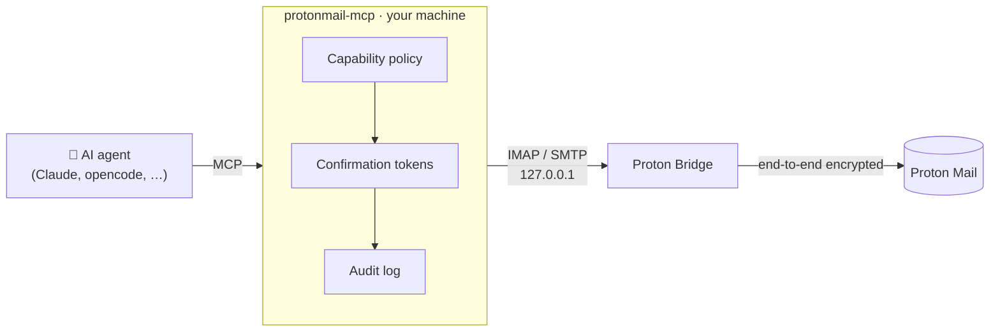
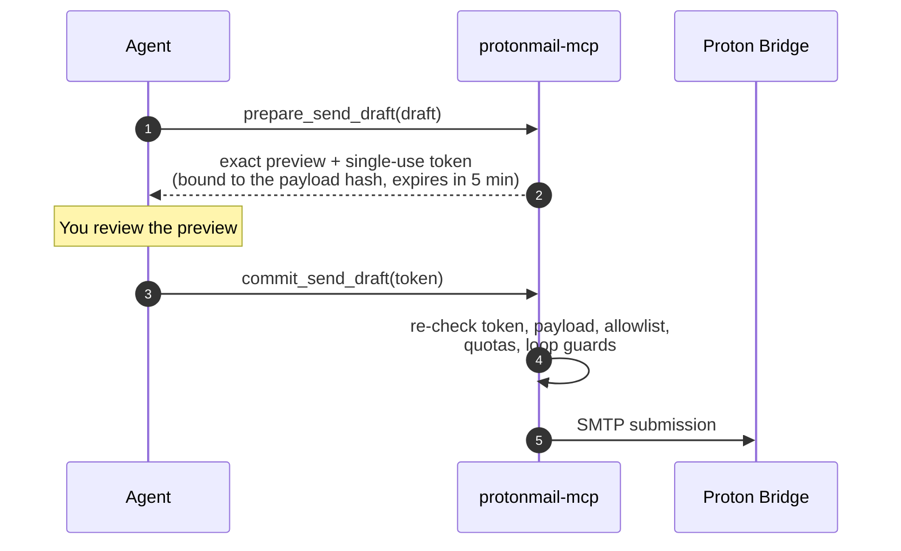

<div align="center">

# protonmail-mcp

**Let your AI agent work your Proton Mail inbox — without handing it the keys.**

An [MCP](https://modelcontextprotocol.io) server for Proton Mail, running entirely on your
machine through [Proton Bridge](https://proton.me/mail/bridge). Read-only by default,
every write previewed before it happens, every limit enforced by the server — not by the prompt.

[](https://pypi.org/project/protonmail-mcp/)
[](https://pypi.org/project/protonmail-mcp/)
[](https://github.com/mhbxyz/protonmail-mcp/blob/main/LICENSE)
[](https://github.com/mhbxyz/protonmail-mcp/actions/workflows/ci.yml)
[](https://github.com/mhbxyz/protonmail-mcp/actions/workflows/codeql.yml)
[](https://scorecard.dev/viewer/?uri=github.com/mhbxyz/protonmail-mcp)

[Quick start](#quick-start) · [Features](#features) · [Security](#security) · [Documentation](https://github.com/mhbxyz/protonmail-mcp/blob/main/docs/README.md)

</div>

---

## Just ask

> *"What came in overnight that actually needs me?"*
>
> *"Find the invoice Acme sent last month and save the PDF."*
>
> *"Draft a polite reply to Alice declining Thursday's meeting."*
>
> *"Archive every newsletter from this week."*

Your agent searches, reads, drafts and tidies your mailbox. You stay in control of
anything that changes, sends or deletes mail.

## Why protonmail-mcp

| 🔒 Safe by default | ✋ You approve every change | 🏠 Nothing leaves your machine |
|---|---|---|
| Starts read-only. Mailboxes are opened `READONLY`; not even the unread flag moves. | Every edit, move, send and deletion is a prepare → commit pair, bound to the exact preview. | Talks only to Bridge on `127.0.0.1`. No telemetry, no third party, no cloud. |

| 🧱 Limits the model can't talk its way past | 🧾 Audited | 🧪 Heavily tested |
|---|---|---|
| Recipient allowlists, quotas, bulk caps and loop guards live in the server. | Every tool call lands in an append-only local JSONL log. | Adversarial, fuzz and capability-matrix tests, plus CodeQL, semgrep and gitleaks on every push. |

## How it works



Proton has no public mailbox API: Bridge is the supported way in. protonmail-mcp wraps
Bridge's local IMAP and SMTP endpoints in a small, auditable set of MCP tools.

## Features

Unlock exactly what you need. Each level adds to the previous one, and tools you have not
enabled simply do not exist for the agent.

| Mode | Your agent can… | Guard rails |
|---|---|---|
| 📖 **read** *(default)* | List, search and read mail, follow threads, get a daily digest, save attachments and `.eml` exports | `READONLY` mailboxes; files only in a local sandbox |
| 📝 **draft** | Write new drafts, reply, reply-all, forward (with original attachments), edit, delete drafts | Writes confined to Drafts; duplicate drafts suppressed |
| 🗂️ **organize** | Mark read/unread, flag, move, archive, trash, label — and undo the last move | Bulk cap (50 by default); Drafts protected |
| 📤 **send** | Send a draft you have reviewed | Recipient allowlist (self-only by default), hourly/daily quotas, size and loop guards |
| 🗑️ **delete** | Permanently erase one message from Trash | Typed confirmation phrase; one message per call; no "empty trash" |

**Also included**

- 🔎 **Smart reading.** Quotes and signatures stripped, HTML rendered to Markdown, link inventory, untrusted-content markers.
- ⚡ **Offline search.** Opt-in local SQLite full-text index for instant queries.
- 🔔 **Live updates.** Opt-in IMAP IDLE notifications as MCP resource updates.
- 👥 **Multiple accounts.** One profile per Proton account, each with its own capability ceiling.
- 🌐 **Runs anywhere.** stdio by default; streamable HTTP with mandatory bearer auth; Docker Compose setup for headless hosts.

→ Full list of tools and resources: [docs/tools.md](https://github.com/mhbxyz/protonmail-mcp/blob/main/docs/tools.md)

## Quick start

**You need:** a paid Proton Mail plan (required by Bridge), and
[Proton Bridge](https://proton.me/mail/bridge) installed, running and signed in. Copy the
**mailbox password** shown in the Bridge UI — it is not your Proton password.

### 1. Install

```bash
uvx protonmail-mcp          # run without installing (recommended)
pipx install protonmail-mcp # or install it
```

### 2. Connect your MCP client

Claude Desktop (`claude_desktop_config.json`):

```json
{
  "mcpServers": {
    "protonmail": {
      "command": "uvx",
      "args": ["protonmail-mcp"],
      "env": {
        "PROTONMAIL_BRIDGE_USERNAME": "you@proton.me",
        "PROTONMAIL_BRIDGE_PASSWORD": "your-bridge-mailbox-password"
      }
    }
  }
}
```

Using opencode or another client, or keeping the password out of the config file? See
[docs/configuration.md](https://github.com/mhbxyz/protonmail-mcp/blob/main/docs/configuration.md#mcp-clients).

### 3. Check the connection

```bash
PROTONMAIL_BRIDGE_USERNAME="you@proton.me" PROTONMAIL_BRIDGE_PASSWORD="..." \
  uvx protonmail-mcp --check
```

You should see your folders and latest messages. That's it — ask your agent about your inbox.

### Unlock more

Set `PROTONMAIL_MCP_MODE` to `draft`, `organize`, `send` or `delete`, or fine-tune
capabilities, allowlists and quotas in `policy.toml`. See the
[configuration guide](https://github.com/mhbxyz/protonmail-mcp/blob/main/docs/configuration.md#capability-policy)
and the annotated [`policy.example.toml`](https://github.com/mhbxyz/protonmail-mcp/blob/main/policy.example.toml).

## Security

Email is attacker-controlled input: a message can try to talk your agent into forwarding
your mail, mass-deleting it, or sending spam. protonmail-mcp is built on the assumption
that the agent *can* be manipulated, and puts the hard limits where the model cannot reach
them.

### Changes are previewed, then committed

New drafts go straight to the Drafts folder. Anything that edits, moves, sends or deletes
existing mail takes two calls:



The token guarantees that what is committed is exactly what was previewed: a replayed,
expired or tampered request is rejected. The server-side policy is the hard limit: even an
agent that skips the review cannot send outside your allowlist or over your quota.

### Guarantees

- **Fail closed.** No configuration means read-only. An invalid policy stops the server from starting.
- **Least privilege.** Disabled capabilities are not registered as tools at all.
- **Server-side policy.** Allowlists, quotas, bulk caps and loop guards are enforced by the server; the agent cannot grant itself privileges.
- **Sandboxed files.** Attachments and exports only touch one directory, with path-traversal protection and filename sanitization. No tool accepts an arbitrary path.
- **Local only.** Bridge on loopback, no telemetry. The test suite blocks non-loopback network access, so none can be added silently.
- **Untrusted content is labeled.** Message bodies are marked as untrusted data for the agent.
- **Deliberately missing.** No raw IMAP/SMTP passthrough, no filter or auto-forward management, no folder creation/deletion, no fetching of links from mail.

Every push runs ruff (bandit rules), strict mypy, adversarial and fuzz tests, gitleaks,
zizmor, pip-audit, semgrep and CodeQL. Read the full threat model and security
architecture in [SECURITY.md](https://github.com/mhbxyz/protonmail-mcp/blob/main/SECURITY.md),
and report vulnerabilities privately through GitHub's **Security → Report a vulnerability**.

> **Keep the Bridge password secret.** Any local process that knows it can read your mail
> through Bridge: that is Bridge's trust model. Prefer your client's environment or
> file-based secret support over inline values.

## Documentation

| | |
|---|---|
| ⚙️ [Configuration](https://github.com/mhbxyz/protonmail-mcp/blob/main/docs/configuration.md) | Environment variables, CLI flags, clients, `policy.toml` |
| 🧰 [Tools and resources](https://github.com/mhbxyz/protonmail-mcp/blob/main/docs/tools.md) | Every tool per capability, resources, index, notifications |
| 👥 [Profiles](https://github.com/mhbxyz/protonmail-mcp/blob/main/docs/profiles.md) | Several Proton accounts |
| 🌐 [HTTP transport](https://github.com/mhbxyz/protonmail-mcp/blob/main/docs/http-transport.md) · 🐳 [Docker](https://github.com/mhbxyz/protonmail-mcp/blob/main/docs/docker.md) | Remote and headless deployments |
| 🛠️ [Development](https://github.com/mhbxyz/protonmail-mcp/blob/main/docs/development.md) | Tests and releases |
| 🧭 [Alternatives](https://github.com/mhbxyz/protonmail-mcp/blob/main/docs/alternatives.md) · 🗺️ [Roadmap](https://github.com/mhbxyz/protonmail-mcp/blob/main/ROADMAP.md) | Other servers, what's next |

---

<div align="center">

MIT licensed · Unofficial: not affiliated with, endorsed by, or supported by Proton AG.
"Proton Mail" and "Proton Bridge" are trademarks of Proton AG.

</div>
